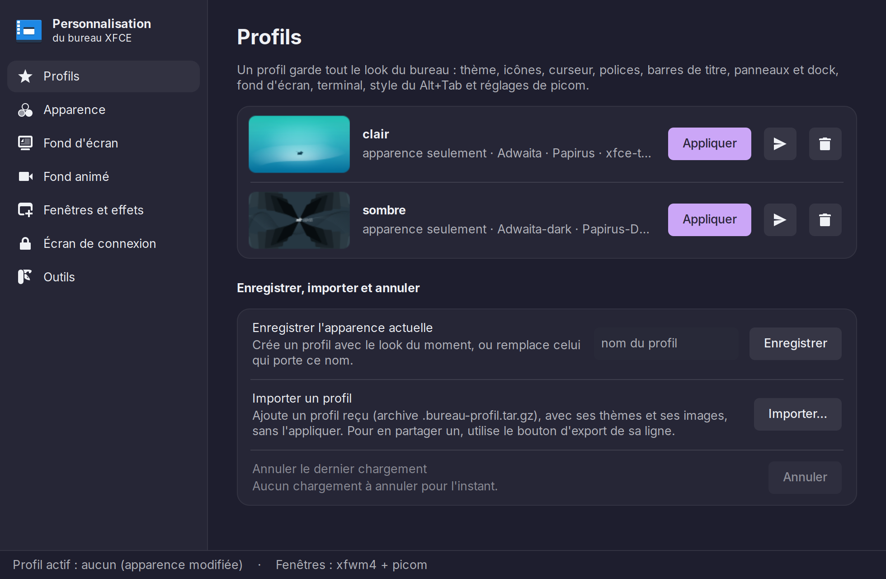
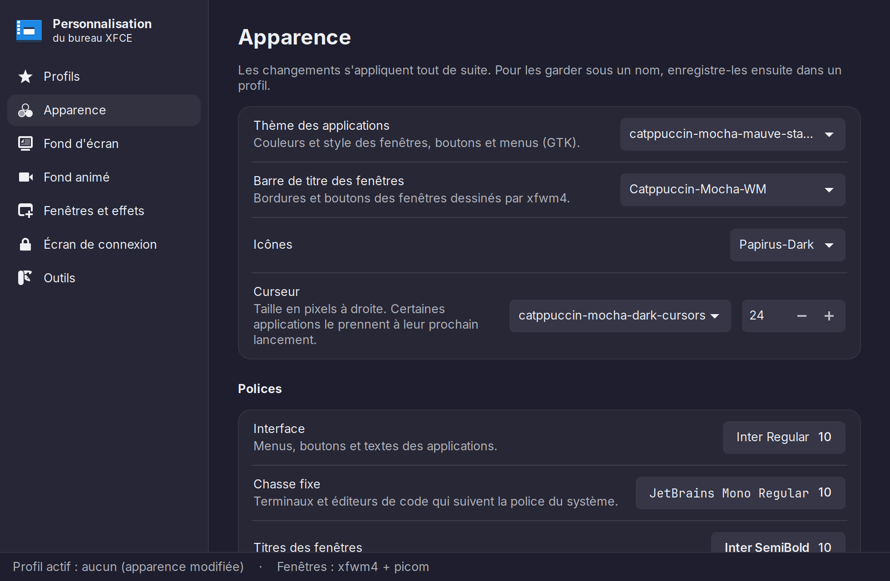
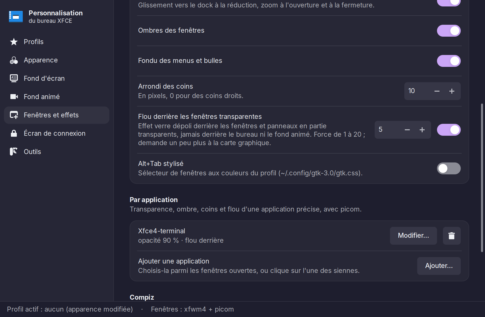

# XfcePersonnaliser

Personnalisation du bureau XFCE (Debian 13, XFCE 4.20) : profils d'apparence complets, à
partager, effets de fenêtres avec picom (flou, règles par application) ou Compiz, écran de
connexion Catppuccin, fond d'écran animé, et une interface graphique qui regroupe le tout.



## Contenu

| Élément | Rôle |
|---|---|
| `bureau-reglages.py` | Interface graphique « Personnalisation du bureau » (GTK 3) |
| `bin/bureau-profil` | Enregistre ou applique un profil d'apparence complet, et l'échange avec d'autres dans une archive (thèmes et images compris) |
| `bin/bureau-wm` | Choix du gestionnaire de fenêtres : xfwm4 + picom ou Compiz |
| `bin/relancer-picom` | Relance picom puis le panneau (sinon la zone de survol du dock part en haut à gauche) |
| `bin/fond-anime` | Fond d'écran animé à partir de vidéos (mpv) : une par écran, changée au bout d'un temps ou à chaque espace de travail |
| `bin/fond-anime-video` | Fenêtre de la vidéo : sous le bureau xfdesktop avec picom en glx, sinon fenêtre de type bureau posée dessus (à la place de xwinwrap) ; met la vidéo en pause quand elle ne se voit pas, et passe à une autre vidéo |
| `bin/fond-anime-fond` | Masque le fond de xfdesktop (couleur rendue transparente par picom) et le remet |
| `config/picom/fond-anime.glsl` | Shader picom qui laisse voir la vidéo derrière les icônes |
| `config/` (autres fichiers) | Réglages de départ : `picom.conf`, style du Alt+Tab, démarrage de picom et de Compiz |
| `bin/bureau-modeles` | Copie les réglages de départ qui manquent, sans jamais écraser un fichier |
| `bin/rendu-logiciel` | Détecte un rendu OpenGL logiciel (machine virtuelle sans 3D) : picom passe alors en xrender |
| `bin/fond-anime-icones` | Icônes affichées par-dessus le fond animé quand la vidéo ne peut pas passer sous le bureau (Compiz, rendu logiciel) |
| `greeter-catppuccin.sh` | Style Catppuccin Mocha pour l'écran de connexion LightDM |
| `man/` | Pages de manuel des commandes, en français (`man fond-anime`…) |
| `captures/` | Captures de l'interface pour cette page |

## Installation

Sur Debian 13 ou plus récent, le plus simple est le paquet Debian de la dernière version, à
télécharger dans les [versions publiées](https://github.com/YakusaFire/XfcePersonnaliser/releases/latest).
Depuis le dossier du téléchargement, il s'installe pour tout le système avec ses dépendances :

```bash
sudo apt install ./xfce-personnaliser_*_all.deb
```

Le paquet met le logiciel dans `/usr/share/xfce-personnaliser/`, les commandes dans
`/usr/bin` et l'entrée « Personnalisation du bureau » dans le menu. Chaque utilisateur
reçoit ses réglages de départ au premier lancement de l'interface : deux profils d'exemple,
`sombre` et `clair`, qui ne changent que l'apparence (thème, icônes, police, panneau, fond) avec
ce que Debian fournit. Les images et vidéos ajoutées depuis l'interface sont rangées dans
`~/.local/share/bureau-reglages/`.

## Dépendances

- XFCE 4.20 (xfwm4, xfdesktop, xfce4-panel), LightDM avec lightdm-gtk-greeter
- Python 3 avec PyGObject (GTK 3) et pycairo
- picom 12 ou plus récent ; Compiz en option (effet Génie)
- mpv, ffmpeg / ffprobe, xrandr pour le fond animé (xwinwrap, absent de Debian, n'est plus utilisé)
- Thèmes non fournis : Catppuccin GTK (Mocha, accent mauve), Papirus, curseurs Catppuccin, WhiteSur.
  L'écran de connexion s'en passe : sans eux, il prend une base Adwaita sombre, les icônes
  Adwaita, les curseurs par défaut et un fond uni (`papirus-icon-theme` et `fonts-inter`
  complètent le rendu).

L'interface grise ce dont le programme manque et donne la commande `sudo apt install …` ;
elle prévient si la session n'est pas XFCE sous X11. Sans accélération graphique (machine
virtuelle sans 3D), picom est réglé en xrender : la vidéo du fond animé ne peut plus passer sous
le bureau (il faut glx), elle se pose dessus et ses icônes sont en lecture seule, comme avec
Compiz.

## Utilisation

Menu **Paramètres → Personnalisation du bureau**, ou la commande `bureau-reglages`.
Chaque commande a sa page de manuel, en français : `man bureau-reglages`, `man bureau-profil`,
`man bureau-wm`, `man fond-anime`, `man relancer-picom`…

| Apparence | Fenêtres et effets |
|---|---|
|  |  |

## Licence

XfcePersonnaliser est un logiciel libre, sous licence GNU GPL version 3 ou ultérieure
(GPL-3.0-or-later). Chacun peut l'utiliser, l'étudier, le modifier et le redistribuer ; une
version redistribuée, modifiée ou non, doit rester sous la même licence et être fournie avec son
code source. Texte complet : [LICENSE](LICENSE).
